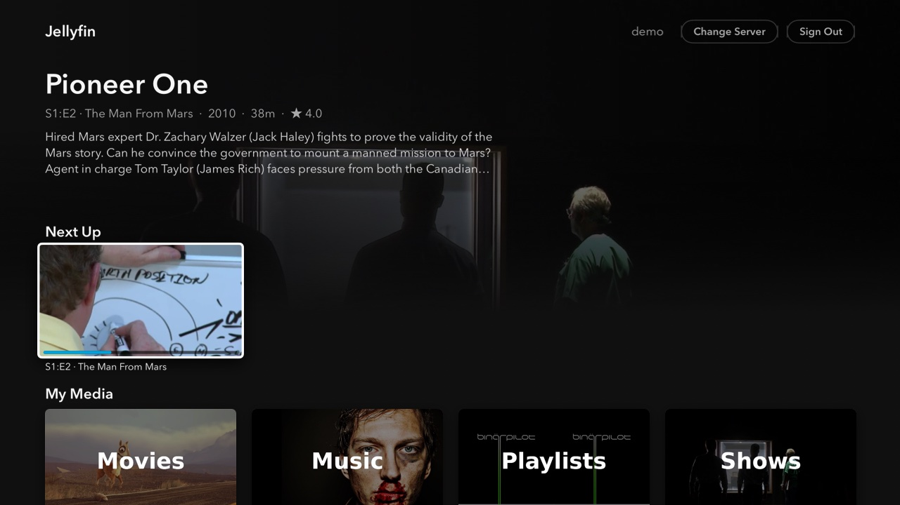
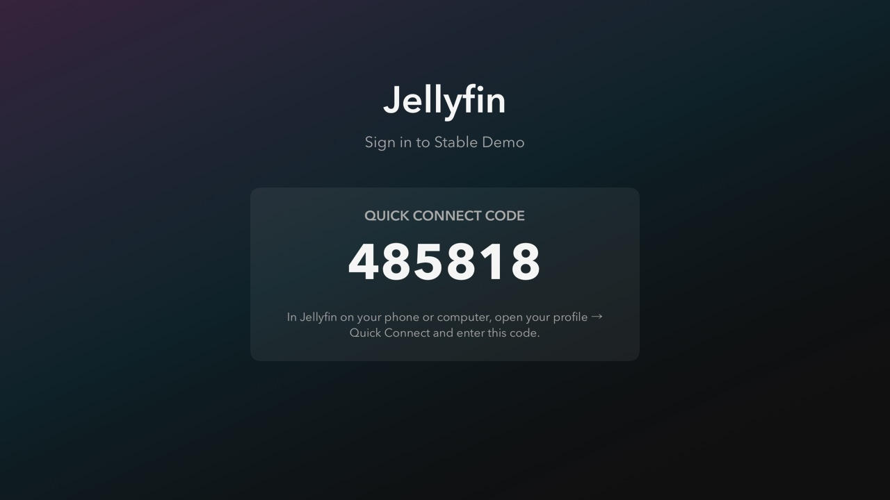
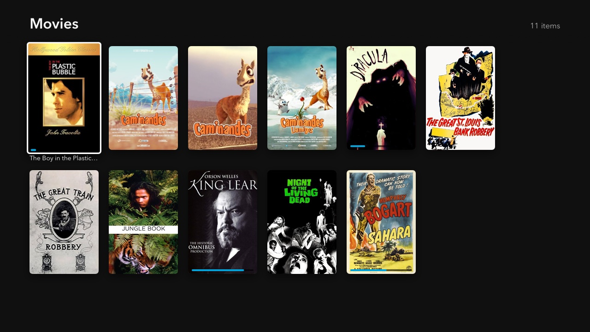
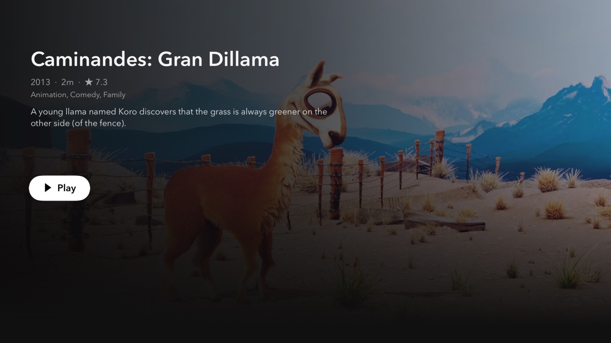
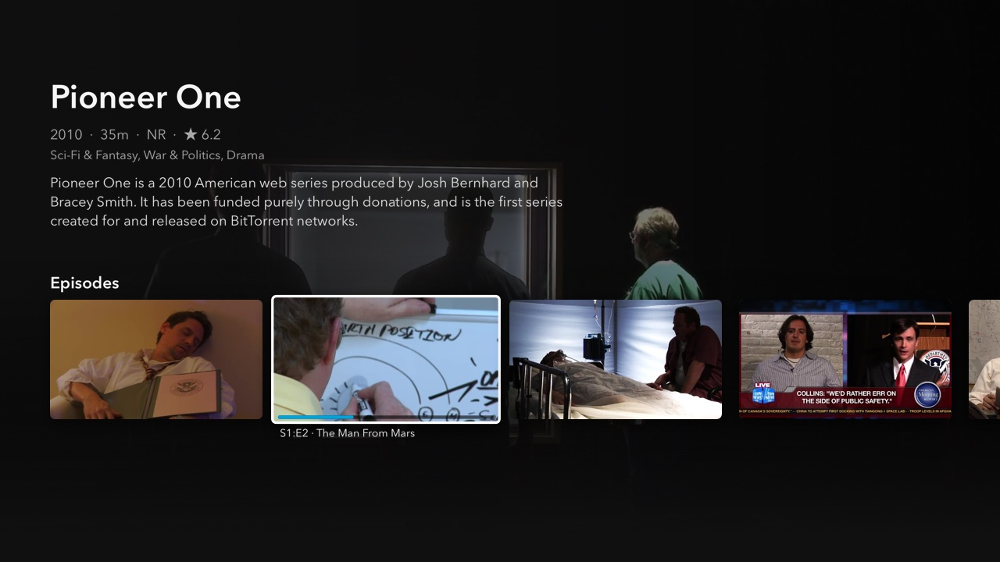

# Jellyfin for Apple TV 3

A native [Jellyfin](https://jellyfin.org) client for the **jailbroken Apple TV 3**
(2012/2013, tvOS/"Apple TV Software" 8.4.x), running as its own tile on the Apple
TV home screen.

> **Unofficial.** This is an independent project. It is not made, endorsed or
> supported by the Jellyfin project; please don't take its issues there.

- Finds your server on the local network by itself
- Signs in with **Quick Connect**: approve a code from your phone, no typing with
  the remote
- Home screen in the style of Jellyfin's TV interface: backdrop of the selected
  item, then Continue Watching, Next Up, My Media and Recently Added rows
- Library grids, movie / episode details, series with seasons and episodes
- Playback on the Apple TV's hardware H.264 decoder through AVPlayer. The server
  is told what the box can play and direct-plays or transcodes to HLS as needed.
- Progress is reported back, so resume points and Continue Watching follow you to
  every other Jellyfin client

| | |
|---|---|
|  |  |
|  |  |
|  | |

<sub>Screenshots: the app's UI code running in the iOS Simulator against
Jellyfin's [public demo server](https://demo.jellyfin.org) (`make screenshots`).</sub>

Tested on an Apple TV 3 rev A (A1469, `AppleTV3,2`) on 8.4.4 jailbroken with
[blackb0x](https://github.com/NSSpiral/blackb0x), against Jellyfin Server 12.4.

## Status

It works, but it's early. Up from the top row of Home reaches **Change Server**,
**Sign Out** and **Exit**. Menu goes back a screen and leaves the app from Home;
holding Menu leaves from anywhere.

## Building

You need a Mac with Xcode, plus [libimobiledevice](https://libimobiledevice.org)
and `ldid` (`brew install libimobiledevice ldid`).

```sh
make sdk       # once: fetches the iPhoneOS 9.3 SDK stubs from theos/sdks
make           # builds build/Jellyfin.frappliance
```

## Installing

### With apt (recommended)

blackb0x installs Cydia's package tools (`apt-get`, `dpkg`) on the Apple TV,
without the Cydia screen. The package links the app into the main menu and sets
its icon, so nothing else is needed.

`make repo` builds the `.deb` and its index in `build/repo`. Serve that folder
from any machine on your network over **plain HTTP**: the Apple TV's OpenSSL
0.9.8 can't connect to today's HTTPS servers, so GitHub Pages won't work.

```sh
make publish REPO_DEST=myserver:/srv/atv-repo   # copy the .deb there and re-index the repo
```

On the Apple TV (over SSH, as root):

```sh
echo 'deb http://myserver:8098/ ./' > /etc/apt/sources.list.d/jellyfin.list
apt-get update
apt-get install io.github.mattkje.jellyfin
```

There is no signed `Release` file, so apt asks to install without
verification. Updates: bump `CFBundleVersion` in `Info.plist`,
`make publish`, then `apt-get update && apt-get install io.github.mattkje.jellyfin`
(or Refresh and Update in [Veyra](https://github.com/mattkje/veyra)).
`apt-get remove io.github.mattkje.jellyfin` takes it off the main menu again.

Up to 0.4 the package was called `org.jellyfin.atv3`. Installing
`io.github.mattkje.jellyfin` replaces it, and keeps the sign-in.

### Over USB, for development

Connect the Apple TV to the Mac with micro-USB **while it is already running**.
If you power it on with the cable attached, it starts in Recovery Mode. The HDMI
output is off while USB is connected.

```sh
make deploy    # copies the bundle to /Applications/Jellyfin.frappliance over afc2
```

The first time, make the home-screen entry. It's a symlink, as Kodi's is, and
the afc2 service can't create one, so use SSH (root password `alpine` unless
you changed it):

```sh
iproxy 2222:22 &
ssh -o HostKeyAlgorithms=+ssh-rsa -o KexAlgorithms=+diffie-hellman-group14-sha1 -p 2222 root@127.0.0.1 \
  'ln -s /Applications/Jellyfin.frappliance /Applications/AppleTV.app/Appliances/Jellyfin.frappliance && killall AppleTV'
```

After that, `make deploy && make reload` installs a new build. `make reload`
asks the running app to restart the home screen.

## Development

Over USB, with the app loaded:

| Command | What it does |
|---|---|
| `make reload` | restart the home screen with the new build |
| `make open` | open Jellyfin as if chosen from the menu |
| `make key K="down right select"` | press remote buttons |
| `make shot` | screenshot of the app to `build/shot.png` |
| `make screenshots` | regenerate the README screenshots in the iOS Simulator |

The app logs to the syslog with a `[Jellyfin]` prefix (`idevicesyslog`).
`tools/waitlog.sh` waits for a new matching line.

### Things learnt the hard way

Today's Xcode can still target this 2012 box, but these all broke it:

- **Thumb code crashes.** The current linker no longer sets the Thumb bit on
  armv7 function pointers (entry point, constructors, ObjC method lists), so
  everything dies with "Illegal instruction". Build with `-marm`.
- **Unsigned code is killed** (`Killed: 9`). Any ad-hoc signature works (`ldid -S`).
- **Never overwrite a binary in place.** iOS caches a file's signature the
  first time it's mapped, so new contents in the same file get killed. Delete,
  then write.
- **No iOS 12+ runtime calls.** Clang turns `[X alloc]` into `objc_alloc()`
  unless built with `-fno-objc-convert-messages-to-runtime-calls`.
- **The appliance must be a symlink** in `AppleTV.app/Appliances`. beigelist
  crashes the home screen on a real folder there.
- **The system font has no glyphs** inside AppleTV.app. Name fonts explicitly
  (Avenir Next, Helvetica Neue).
- **BackRow's root layer is y-up.** UIKit layout under it shows upside down,
  so the app flips its own root layer. Raw `layer.contents` images flip too, so
  images are drawn in `-drawRect:`.
- **Menu icons come from a cache**, `Caches/AppleTV/MainMenu/<bundle id>@720.png`
  (188×108) and `@1080.png` (284×161). `make deploy` writes both.
- **The A5 can't decode H.264 above level 4.1** (AVFoundation error -11848), so
  the device profile caps it.

There's no BackRow SDK. All of the BackRow classes live inside AppleTV.app, so
the appliance builds its subclasses at run time with the Objective-C runtime.
That's the approach Kodi's ATV2 port took; reading its source was invaluable.

## Credits

- Jellyfin logo from [jellyfin-ux](https://github.com/jellyfin/jellyfin-ux),
  CC BY-SA 4.0
- Appliance technique learnt from Kodi's ATV2 port
  (`xbmc/osx/atv2`, Kodi 14)
- beigelist by nito, which loads appliances on the Apple TV 3

## License

GPL-3.0. See [LICENSE](LICENSE).
